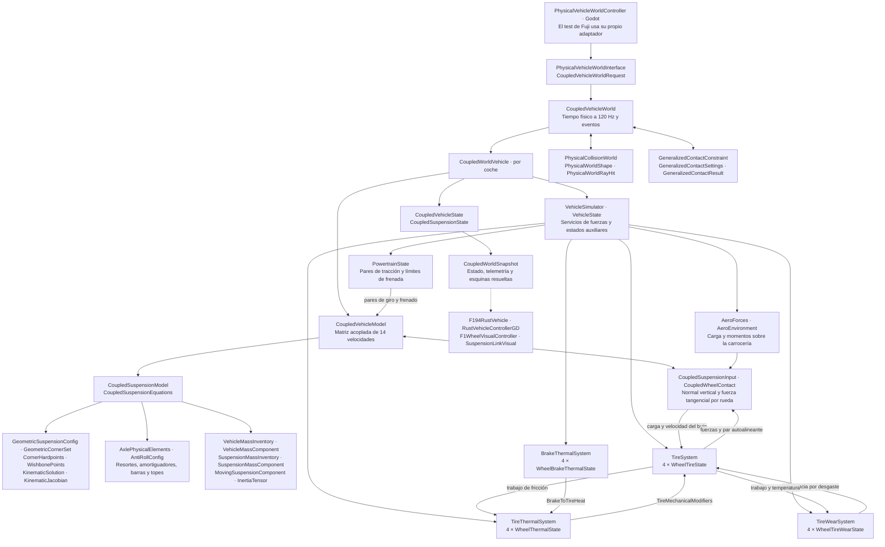
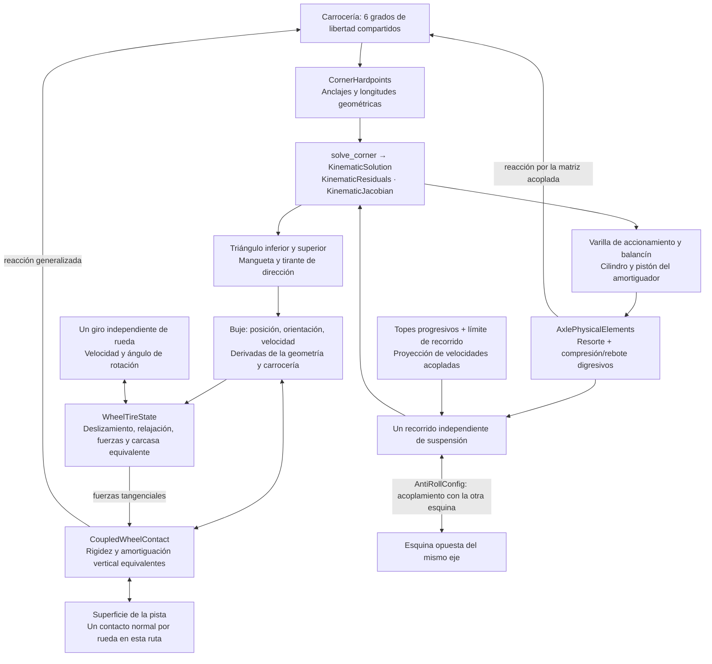
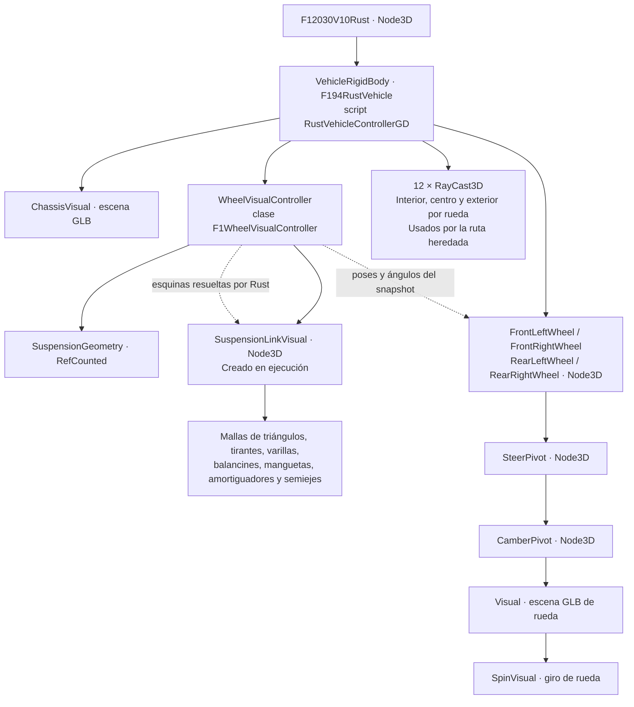

# Mapa actual de suspensión, ruedas y neumáticos

Inspección del código de `main-clean`, HEAD
`f7fa7d46b559538a8dd80819f2f52e0dd7997573`, con los cambios locales del candidato.
El diagrama principal corresponde al mundo acoplado usado en las pruebas de Fuji.
La ruta heredada aparece por separado: su existencia no significa que ambas
integren simultáneamente el vehículo.

## Autoridad física y relaciones entre subsistemas

Los cuadros contienen nombres reales de estructuras Rust o clases Godot. Las
flechas representan composición o intercambio de datos, no necesariamente
herencia ni orden completo de ejecución.

## Una esquina: se repite cuatro veces

El semieje tiene masa y movimiento derivados de la geometría en las esquinas
que lo declaran. La rotación de las piezas marcadas como rotor comparte el giro
de su rueda; cada pieza no tiene un giro independiente.

## Detalle real y aproximaciones

| Elemento | Implementación actual | Límite del detalle |
| --- | --- | --- |
| Coordenadas mecánicas | 6 de carrocería + 4 recorridos + 4 giros de rueda = 14 velocidades generalizadas | La cremallera está prescrita; no es un grado dinámico adicional |
| Inventario físico | 80 componentes con masa, centro e inercia | No son 80 cuerpos rígidos libres; sus movimientos están restringidos por la geometría |
| Articulaciones | Anclajes, triángulos, manguetas, tirantes, varillas y balancines resueltos geométricamente | Sin flexión estructural ni elasticidad de casquillos en este mecanismo |
| Amortiguador | Compresión/rebote distintos, rodilla y rama rápida; relación de movimiento geométrica | Ley equivalente de fuerza, sin dinámica interna detallada de válvulas o fluido |
| Barras estabilizadoras | Fuerza conservativa entre recorridos izquierdo y derecho | No una barra flexible distribuida |
| Topes | Fuerza progresiva, amortiguación y restricciones de recorrido | Su estabilidad conjunta con el integrador requiere validación |
| Ruedas | Masa e inercia de piezas, giro, momentos de contacto y acoplamiento con la carrocería | Sin llanta deformable ni vibración estructural de radios |
| Neumático vertical | Penetración equivalente, rigidez y amortiguación unilateral | Sin malla deformable ni elementos finitos |
| Fuerzas del neumático | Slip longitudinal/lateral, relajación, combinación de adherencia, sensibilidad a carga, camber, resistencia y par autoalineante | Modelo compacto calibrable; no una discretización de cada elemento de goma |
| Huella | Tamaño y propiedades equivalentes en TireSystem | En el mundo acoplado la normal usa un contacto/rayo por rueda; las tres muestras del adaptador contienen el mismo impacto |
| Temperatura | Tres bandas de rodadura, carcasa y gas por neumático | Cinco estados térmicos concentrados; no un campo continuo |
| Presión | Estado de presión y modificadores mecánicos/térmicos | La fuerza vertical del mundo acoplado utiliza sus propios coeficientes configurados; no todos los modificadores de la ruta heredada están conectados a esa ley vertical |
| Desgaste | Tres bandas, profundidad, trabajo acumulado y factor de adherencia | Desgaste equivalente, sin geometría superficial distribuida |
| Frenos | Límites de par, impulsos disipativos y estado térmico por rueda | Contabilidad completa de motor/ejes/embrague todavía pendiente en el candidato |
| Terreno | Mallas de colisión verificadas, consultas geométricas y contactos generalizados | Las mallas visuales no representan por sí mismas la resolución del contacto del neumático |
| Integración | Mundo a 120 Hz, subdivisión por eventos y fuerza reevaluada | Fallo confirmado de asentamiento/amortiguación a 120 Hz; el detalle del modelo no implica estabilidad validada |

Inventario agrupado por tipo de anclaje del perfil actual:

| Anclaje | Componentes |
| --- | ---: |
| Carrocería | 17 |
| Cremallera | 1 |
| Mangueta | 12 |
| Rotor de rueda | 16 |
| Triángulo inferior / superior | 4 / 4 |
| Tirante de dirección | 4 |
| Varilla de accionamiento | 4 |
| Balancín | 4 |
| Cilindro / pistón de amortiguador | 8 / 4 |
| Semieje | 2 |

## Nodos y representación en Godot

El controlador soporta nodos `Spinner` cuando están disponibles; la escena
inspeccionada enlaza sus rutas de giro a `Visual/SpinVisual`. No debe
confundirse el árbol visual con el inventario dinámico. El adaptador del mundo
acoplado entrega poses autoritativas: Godot no vuelve a integrar esas piezas.

## Catálogo de estructuras auxiliares

Estas estructuras completan los diagramas; no añaden grados de libertad por sí
solas.

| Área | Tipos presentes |
| --- | --- |
| Estado/evaluación acoplada | `CoupledVehicleEvaluation`, `CoupledSuspensionEvaluation`, `CoupledSuspensionDiagnostics`, `CoupledSuspensionDefinition`, `CoupledFuelMassExchange`, `GeneralizedWheelBrakingResult` |
| Configuración del mundo | `CoupledVehicleWorldConfiguration`, `CoupledSuspensionSettings`, `VehicleCollisionBox`, `TimestampedVehicleInput`, `CoupledWorldCollisionEvent` |
| Geometría | `SuspensionModelKind`, `RodMount`, `RodKindLabel`, `CornerProvenanceOrigin`, `CornerProvenance`, `SuspensionGeometryEvaluationCache`, `SharedSuspensionGeometrySolutions`, `SuspensionComponentPose`, `ComponentKinematicInput` |
| Masas | `MassComponentAttachment`, `MassPropertyOrigin`, `MassPropertyProvenance`, `VehicleMassBudget`, `ComponentMassUncertainty`, `VehicleMassInventoryAudit`, `SuspensionCornerMassAudit`, `SuspensionMassAudit` |
| Contacto/paquete | `PhysicalWorldPackage`, `PhysicalWorldShapeDefinition`, `PhysicalShapeContact`; tipos de resultado de las consultas geométricas |
| Neumáticos | `WheelMechanicalTuning`, `TireForceProfile`, `TireSlipRegime`, `PureSlipResponse`, `TireMechanicalModifiers` |
| Térmica/presión | `TirePressureConfig`, `TireThermalConfig`, `TireThermalAxleConfig`, `PressureMechanicsSensitivity`, `TireEnvironment`, `TireThermalInput` |
| Desgaste | `TireWearConfig`, `TireWearAxleConfig` |
| Térmica de frenos | `BrakeThermalConfig`, `BrakeAxleThermalConfig`, `ResolvedBrakeAxleThermalConfig`, `BrakeDuctAxleConfig`, `BrakeDuctFlowState`, `BrakeThermalInput`, `BrakeToTireHeat` |

## Ruta heredada que también permanece en el código

`VehicleSimulator` → `SuspensionSystem` → cuatro `WheelSuspensionState`.
Utiliza `PreparedGeometricSuspension`, cuatro `PreparedWheelEnvelope`, tablas
`CornerTable`/`TableSample`, y estructuras de reacciones/modos
`AnchorReaction`, `WheelLoadPaths`, `BodyModes`, `LinkFrame`, `GeoWheelWrench`.
Las muestras `TriRaycastSample`/`RaycastHit` alimentan su contacto por tres rayos.
Los sistemas de neumático, temperatura y desgaste son servicios compartidos.

En modo acoplado, `CoupledVehicleForceContext` inyecta cargas, velocidades y
recorridos autoritativos en esos estados de servicio. La rama de
`SuspensionSystem.step_with_modifiers` se omite: no se suman dos suspensiones.
Los datos de rayos en esa ruta se rellenan a partir de una sola consulta por
rueda. La selección explícita de modo determina quién integra la carrocería.

## Fuentes inspeccionadas

- `game/crates/vehicle-physics-engine/src/coupled_vehicle_world.rs`
- `game/crates/vehicle-physics-engine/src/coupled_vehicle_dynamics.rs`
- `game/crates/vehicle-physics-engine/src/suspension_coupled_solver.rs`
- `game/crates/vehicle-physics-engine/src/suspension_multibody.rs`
- `game/crates/vehicle-physics-engine/src/suspension_component_kinematics.rs`
- `game/crates/vehicle-physics-engine/src/suspension_kinematics.rs`
- `game/crates/vehicle-physics-engine/src/suspension_geo_config.rs`
- `game/crates/vehicle-physics-engine/src/suspension_mass_properties.rs`
- `game/crates/vehicle-physics-engine/src/vehicle_mass_inventory.rs`
- `game/crates/vehicle-physics-engine/src/simulation.rs`
- `game/crates/vehicle-physics-engine/src/tire.rs`
- `game/crates/vehicle-physics-engine/src/tire_thermals.rs`
- `game/crates/vehicle-physics-engine/src/tire_wear.rs`
- `game/crates/vehicle-physics-engine/src/brake_thermals.rs`
- `game/crates/vehicle-physics-engine/src/physical_collision_world.rs`
- `game/crates/vehicle-physics-engine/src/generalized_vehicle_contacts.rs`
- `game/data/vehicles/f1_2030/profiles/geometric/chassis.json`
- `game/scripts/runtime/physical_vehicle_world_controller.gd`
- `game/scripts/vehicle/f1_wheel_visual_controller.gd`
- `game/scripts/vehicle/suspension_geometry.gd`
- `game/scripts/vehicle/suspension_link_visual.gd`
- `game/scenes/vehicles/f1_2030_v10/f1_2030_v10_rust.tscn`

El nivel de detalle descrito corresponde a lo conectado en código. No certifica
la fidelidad de los coeficientes, la convergencia del integrador ni la calidad de
una vuelta completa.
